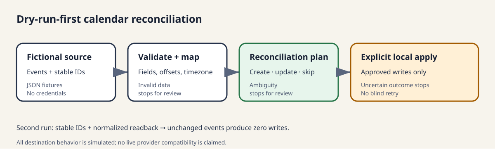

# Calendar Integration Demo

A small, credential-free backend portfolio demonstration by **Mathist Consulting**. It shows a safe calendar reconciliation workflow without a frontend, scheduler, hosted service, authentication layer, or live provider integration.



## Business problem

Calendar integrations have to decide what changed without creating duplicates or overwriting good provider data. A useful implementation needs stable identity, explicit field ownership, readable plans, safe failure handling, and proof that a second run does not repeat successful work.

This self-initiated demo is derived from engineering patterns in my own calendar automation project. The code and fixtures here were newly written as a standalone public-review candidate.

## What the demo does

- reads fictional source events and simulated destination-provider state;
- validates required fields and maps offset-aware timestamps into UTC;
- matches records by stable `source_id`, never by title alone;
- plans `create`, `update`, `skip`, or `review` outcomes;
- defaults to dry-run and writes nothing in that mode;
- applies only explicitly approved create/update types to local generated JSON;
- reports actual simulated operations separately from planned actions;
- blocks ambiguous matches, invalid records, cancellations, and uncertain writes for review;
- demonstrates repeat-run idempotency and deterministic provider failures.

## Requirements

- Python 3.11 or newer
- Git only for the optional publication audit
- no third-party Python packages
- no credentials or network access

Run commands from the repository root.

## Quick start

Default dry run (writes nothing):

```powershell
python -m calendar_demo
```

Apply the safe create and update plan to local simulated state:

```powershell
python -m calendar_demo run --apply --approve create --approve update
```

Run it again. The previously created and updated records should now be `skip`, with zero provider operations:

```powershell
python -m calendar_demo run --apply --approve create --approve update
```

Failure and uncertainty scenarios:

```powershell
python -m calendar_demo run --scenario provider-failure --apply --approve update
python -m calendar_demo run --scenario uncertain-write --apply --approve create
python -m calendar_demo run --scenario uncertain-write --apply --approve create
```

Run all tests:

```powershell
python -m unittest discover -s tests -v
```

Reset only known generated state/report files:

```powershell
python -m calendar_demo reset
```

Run the bounded publication audit after files are tracked by Git:

```powershell
python scripts/publication_audit.py
```

## Scenarios

The `portfolio` scenario contains a new event, a changed event, an unchanged event, duplicate destination matches, invalid input, and a canceled event. Separate scenarios demonstrate a provider failure before mutation and a create that may have succeeded before its response was lost.

The uncertainty marker is durable in generated local state. A repeat run produces `review` and performs no second create. Clearing that marker is intentionally a manual operator decision.

## Output and local state

Dry runs print a report to the terminal and do not create files. Apply runs write only:

- `generated/<scenario>-state.json`
- `generated/<scenario>-report.json`

Those JSON files are ignored by Git. The reset command enumerates exact known filenames, verifies they are direct children of `generated/`, and never recursively deletes a directory.

A reproducible dry-run illustration is in [`examples/portfolio-dry-run.txt`](examples/portfolio-dry-run.txt).

## Safety and limitations

All destination-provider behavior is simulated in local Python code. This demo does **not** verify a live Meetup, Eventbrite, Google Calendar, or SDK integration. It makes no external network calls and does not implement provider authentication, API retries, webhooks, scheduling, or deployment.

The fixtures use `America/Denver`. Python's system IANA timezone database is used when available; a dependency-free fallback validates `America/Denver` and `UTC`, including U.S. daylight-saving transitions, on Windows installations without that database. Other named zones fail closed unless the host provides IANA timezone data.

Canceled records are never automatically deleted. Missing descriptions and other required fields become review items instead of clearing destination values. Provider failures are reported without a write. Uncertain writes stop future automatic creates until a person resolves the marker.

See [`docs/design-notes.md`](docs/design-notes.md) for source-of-truth, identity, idempotency, uncertainty, and adapter-boundary details.

## Portfolio materials

- [`docs/case-study.md`](docs/case-study.md)
- [`docs/upwork-portfolio-copy.md`](docs/upwork-portfolio-copy.md)
- [`docs/publication-review.md`](docs/publication-review.md)
- [`assets/workflow.svg`](assets/workflow.svg)

## Attribution and license decision

The implementation uses only the Python standard library. It was written specifically for this demo and does not copy production source files, configuration, credentials, event data, or internal documentation.

This project is available under the [MIT License](LICENSE).
